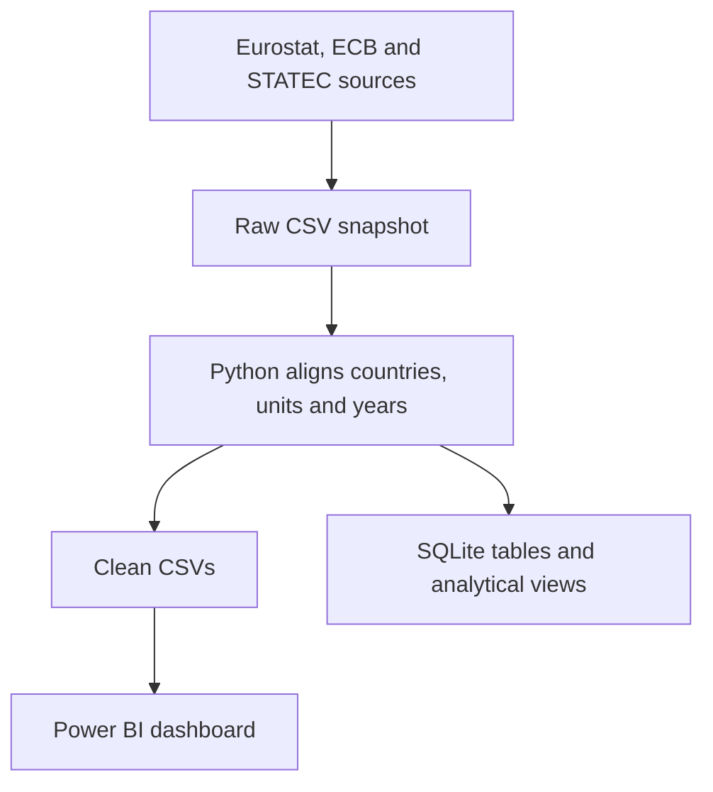

# Luxembourg Housing, Employment and Banking

This project brings together 19 years of housing, employment and banking data for Luxembourg and its peers. A Python pipeline prepares the source files for SQLite and a three-page Power BI dashboard.


## Where did the 190,400 commuters come from?

The overview rounds the 2023 cross-border worker count to 190K. The exact total comes from three rows in the cleaned data.

| Country of residence | Workers in the 2023 snapshot |
| --- | ---: |
| France | 104,600 |
| Belgium | 50,200 |
| Germany | 35,600 |
| **Total** | **190,400** |

```sql
SELECT residence_country, worker_count,
       SUM(worker_count) OVER () AS workers_total
FROM crossborder_workers
WHERE year = 2023
ORDER BY worker_count DESC;
```

The same dashboard shows a 2023 Luxembourg house price index of 210.47 with 2010 set to 100. The cleaner filters the housing input to the existing-dwellings index before averaging quarterly observations into annual values. The raw file also contains percentage-change series.

## From source files to dashboard



SQLite includes views for affordability, cross-border employment, banking growth, peer comparisons and regression inputs. The analysis notebook uses observational data for exploratory analysis. [Cleaning script](02_clean.py) · [SQLite views](sql/schema.sql) · [Analysis notebook](notebooks/04_analysis.ipynb)

## Data provenance

- The [tracked-file inventory](data/raw/input_inventory.json) records row counts and hashes for this snapshot. The [earlier collection log](data/raw/_provenance.json) records the collector's reported status at the time. For example, the current commuter CSV has 57 rows and the current house-price CSV has 31,528 rows. The exact retrieval history of later file replacements is unrecorded.
- Eurostat is the source for the house price index and housing cost overburden series. The ECB Data Portal is the reference for banking assets. STATEC publishes cross-border worker counts by country of residence. [Eurostat](https://ec.europa.eu/eurostat) · [ECB Data Portal](https://data.ecb.europa.eu/) · [STATEC](https://lustat.statec.lu/)
- The cleaner uses reference values where some inputs are missing and interpolates parts of the wage and employment series. The current SQLite build has no Luxembourg financial-sector employment share for 2023. The financial employment chart in the original third dashboard export shows an older snapshot.

## Open or rebuild

Open the [Power BI workbook](powerbi/dashboard.pbix) in Power BI Desktop. The workbook uses the clean CSVs and may need its source paths updated to your checkout. The [SQLite database](data/clean/luxembourg_analytics.db) and [dashboard exports](reports/) are in the repository.

Install the packages in [requirements.txt](requirements.txt) and run `python 02_clean.py` from a fresh checkout to rebuild the clean CSVs and SQLite database from the checked-in inputs. The optional [collector](01_collect.py) refreshes raw inputs from external sources.
