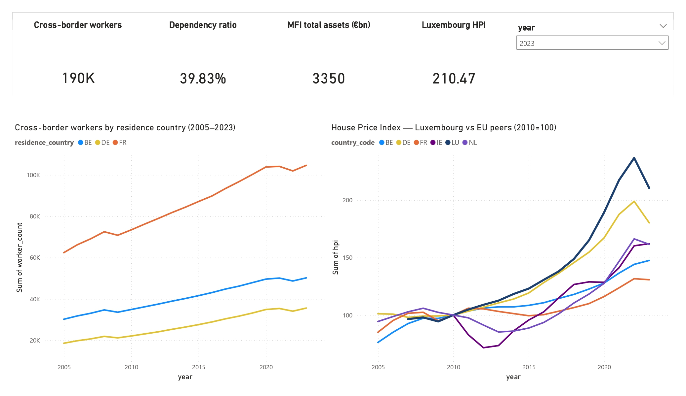

# Luxembourg Housing, Employment and Banking

I built this project to compare how housing prices, cross-border employment and bank assets changed in Luxembourg from 2005 to 2023. A Python pipeline prepares the source files for SQLite and a three-page Power BI dashboard.



The 2023 worker count is a useful example. The clean data records 50,200 commuters living in Belgium, 35,600 in Germany and 104,600 in France, for a total of 190,400. The Luxembourg house price index for the same year was 210.47, with 2010 set to 100.

```sql
SELECT SUM(worker_count) AS cross_border_workers
FROM crossborder_workers
WHERE year = 2023;
```

## Data and methods

- [Eurostat](https://ec.europa.eu/eurostat) supplies the house price index (`prc_hpi_q`) and housing cost overburden series (`ilc_lvho07c`).
- The [ECB Data Portal](https://data.ecb.europa.eu/) is the source for the banking asset series. The [STATEC portal](https://lustat.statec.lu/) publishes worker counts by country of residence.
- The [cleaning script](02_clean.py) uses reference values when some source files are missing and interpolates some employment and wage series between reference years. The built employment table has a missing financial-sector share for Luxembourg in 2023.
- The [analysis notebook](notebooks/04_analysis.ipynb) compares housing and banking indicators and fits an exploratory regression using observational data.

## Open or rebuild

Open the [Power BI workbook](powerbi/dashboard.pbix) in Power BI Desktop. The workbook uses the clean CSVs and may need its source paths updated to your checkout. The [SQLite database](data/clean/luxembourg_analytics.db) and [dashboard exports](reports/) are in the repository.

Install the packages in [requirements.txt](requirements.txt) and run `python 02_clean.py` from a fresh checkout to rebuild the clean CSVs and SQLite database from the checked-in inputs. The optional [collector](01_collect.py) refreshes raw inputs from external sources.
